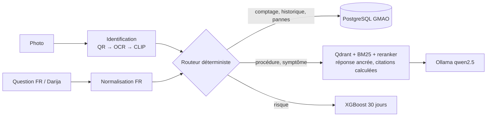

# Assistant de maintenance multimodal (RAG + Vision + Agent + Prédictif)

Assistant hors ligne pour opérateurs et techniciens : photo d'une machine, identification,
fiche et historique GMAO, procédures tirées des manuels (français / darija), risque de panne à 30 jours.



## Lancer
```bash
docker compose up -d --build   # UI : :8501 · API : :8000/docs
```

## Principes de fiabilité
- Routage en code pour les données critiques (pas de choix d'outil par le LLM).
- Étapes recopiées du manuel, vérifiées par ancrage lexical ; pages citées calculées par le code.
- Refus si le meilleur extrait est sous le seuil du reranker.
- Identification par photo : toute lecture incertaine demande une confirmation.

## Résultats (données synthétiques)
| Évaluation | Résultat |
|---|---|
| Recherche (hit@1, MRR) dense / hybride / reranker | 0.84 / 0.88 / 0.97 (MRR) |
| Évaluation de bout en bout | _à remplir_ |
| Modèle prédictif (AUC vs règle simple) | _à remplir_ |

## Limites
Manuels et historique **synthétiques** ; Darija compris via un LLM 7B local (réponses en français) ;
le modèle prédictif apprend la fonction de risque simulée, pas une panne réelle.